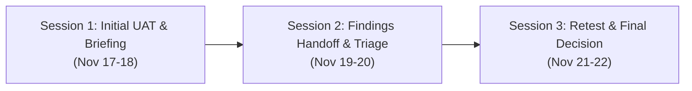

# CPMS Sprint 1 UAT Handoff Package for Partner Team

**Course**: CPE334 Software Engineering (Semester 1/2026)  
**Project Theme**: Theme 6 — Course Project Management System (CPMS)  
**Product Team**: James (`maneejames`), Kan (`KanPhacharawat`)  
**Target Partner Team**: Independent UAT Partner Team (Two Assigned Students)  
**Document Status**: Official Handoff Package for Lab 6 Part A  
**Submission Due Date**: 22 November 2026 at 23:59  

---

## 1. Release Baseline & Deployed Target Environment

This handoff package defines the tested baseline and deployment targets for the independent verification of CPMS Sprint 1.

### 1.1 Deployment Details
| Item | Specification / Value |
|---|---|
| **Live Deployed URL** | `https://cpms-wpsgfzameq-as.a.run.app` |
| **Health Liveness Check** | `https://cpms-wpsgfzameq-as.a.run.app/api/health` (HTTP 200 `{ ok: true }`) |
| **Readiness Smoke Check** | `https://cpms-wpsgfzameq-as.a.run.app/api/ready` (HTTP 200 `{ ok: true, database: "up" }`) |
| **Cloud Runtime** | Google Cloud Run (Region: `asia-southeast1`) |
| **Database Instance** | Google Cloud SQL (PostgreSQL 16) |
| **Baseline Release Tag** | `v0.1.0` |
| **Sprint 1 Baseline Commit** | `3da07d0` |
| **Deployed Revision Commit** | `a11fdc0` (Merged into `main` with Lab 5 deployment proof) |
| **Git Repository URL** | `https://github.com/KanPhacharawat/softwareengineering-project` |

### 1.2 Main Freeze Policy
> [!IMPORTANT]
> **Main Branch is Frozen**: Per Lab 6 rules, the `main` branch is frozen for the duration of the UAT exercise. No unannounced code changes, refactors, or Sprint 2 features will be deployed to the live Cloud Run URL while testing is active. Any changes require prior written notice and agreement with the UAT partner team.

---

## 2. Accepted-for-Test Scope (Sprint 1 Contract Only)

The UAT Team evaluates the application strictly against the delivered **Sprint 1 specification (SRS v1.0, Features F-00 through F-05)**.

### 2.1 In-Scope Features (Accepted for Testing)
* **F-00: Project Setup & Fixtures**: Seeded synthetic users, teams, and memberships; reproducible environment.
* **F-01: Authentication & Sessions (`FR-01`, `FR-02`, `FR-03`)**:
  * Email and password login yielding authenticated cookie sessions.
  * Logout with server-side session invalidation.
  * Retrieval and display of authenticated user identity (Name, Email, Role).
* **F-02: Role & Team Authorization (`FR-04`, `BR-01`, `BR-02`, `BR-03`, `NFR-03`)**:
  * Strict tenant isolation: Students can only view their own team and its deliverables.
  * Supervisor scoping: Supervisors can only view and manage teams assigned to them.
  * Cross-team traversal attempts return HTTP 404 (zero disclosure of other teams).
* **F-03: Milestone Creation (`FR-05`, `FR-06`, `BR-04`)**:
  * Assigned supervisors can create milestones with title (3–120 chars) and future due date/time.
  * Team members and assigned supervisors can list milestones with status badges.
* **F-04: Team Submission (`FR-07`, `FR-08`, `FR-09`, `BR-05`, `BR-06`, `BR-09`)**:
  * Exactly one submission per team per milestone (title, description, valid HTTP/HTTPS link).
  * Any team member can edit the submission prior to the deadline and prior to feedback.
* **F-05: Supervisor Feedback & Lock (`FR-09`, `FR-10`, `BR-07`, `BR-08`)**:
  * Supervisor records written feedback attached to a team submission.
  * Recording feedback locks the submission permanently; students can no longer edit.
  * Exactly one feedback record per submission version.

### 2.2 Explicitly Out-of-Scope (Sprint 2 & 3 Features)
> [!WARNING]
> The following features belong to Sprint 2 or Sprint 3. They are **NOT** part of Sprint 1 acceptance. Any finding submitted regarding these items is **NOT a defect** and will be triaged as an out-of-scope enhancement:
> * **F-06**: Revision requests, resubmissions, and revision history.
> * **F-07**: Milestone editing and closing.
> * **F-08**: Numeric grading of submissions.
> * **F-09 & F-10**: Team progress boards and supervisor cross-team summary reports.
> * **File Uploads**: CPMS is designed to accept deliverable links (e.g. GitHub PR, Google Drive URL), not uploaded files.

---

## 3. Account Directory & Role Scoping

### 3.1 Test Account Directory
All test accounts are pre-seeded synthetic accounts. To maintain security, credentials are not committed to Git.

| Account Label | Email Address | System Role | Assigned Scope | Intended Test Usage |
|---|---|---|---|---|
| **Supervisor One** | `sup1@cpms.test` | `SUPERVISOR` | Team Alpha, Team Beta | Primary supervisor: milestone creation, feedback recording, normal journey |
| **Supervisor Two** | `sup2@cpms.test` | `SUPERVISOR` | Team Gamma only | Verification of unassigned supervisor access rejection (404 / access denied) |
| **Student One** | `s1@cpms.test` | `STUDENT` | Team Alpha | Primary student submitter for Team Alpha |
| **Student Two** | `s2@cpms.test` | `STUDENT` | Team Alpha | Teammate collaboration: editing submission, verifying shared state |
| **Student Three** | `s3@cpms.test` | `STUDENT` | Team Beta | Cross-tenant isolation verification: cannot see or access Team Alpha |
| **Student Four** | `s4@cpms.test` | `STUDENT` | Team Beta | Secondary student in Team Beta |
| **Student Five** | `s5@cpms.test` | `STUDENT` | Team Gamma | Tenant isolation verification for Team Gamma |
| **Student Six** | `s6@cpms.test` | `STUDENT` | Team Gamma | Secondary student in Team Gamma |

### 3.2 Private Credential Distribution Policy
* **Zero Secrets in Repository/PDF**: In strict accordance with course academic integrity and security policies, actual passwords are never written in markdown files or submitted PDFs.
* **Transmission Method**: The shared course test password for all seeded accounts has been transmitted directly and securely to the UAT Partner Team via the private course Discord/Teams channel.
* If credentials need to be re-sent, contact `@maneejames` or `@KanPhacharawat`.

---

## 4. Test Data Rules & Reset Instructions

1. **Naming Convention**:
   * All test milestones, submissions, and artifacts created by the UAT team must use the prefix:  
     `UAT-<partnerTeam>-<caseId>` (e.g., `UAT-TeamX-01`, `UAT-TeamX-Submission`).
2. **Synthetic Data Only**:
   * Use only synthetic titles, dummy URLs (e.g. `https://github.com/example/demo`), and placeholder text.
   * Do not submit real student IDs, personal phone numbers, or genuine secrets.
3. **Data Isolation & Cleanliness**:
   * Tests are self-contained and operate on newly created milestones with future dates.
   * If database state ever needs a fresh reset, the Product Team can trigger the migration/seed Cloud Run Job (`cpms-migrate`) upon request.

---

## 5. Agreed UAT Coordination Sessions

To ensure all required activities of Parts A, B, C, and D are completed before the 22 November 2026 deadline, the Product Team and UAT Team have agreed to the following 3 coordination sessions:

### Session 1: Initial UAT Execution & Briefing
* **Target Timeline**: 17–18 November 2026
* **Channel**: Online sync / Course Discord + GitHub Issue Tracker
* **Participants**: Both Product Team members (`maneejames`, `KanPhacharawat`) and both UAT Partner Team members.
* **Agenda**:
  1. Handoff package walkthrough and confirmation of live URL accessibility (`/api/ready`).
  2. Exchange and verification of private credentials.
  3. UAT Team executes agreed test cases ([`UAT-01` through `UAT-06`](README.md)).
  4. Both partner testers participate and record independent observations and screenshots (`E-B01` through `E-B06`).

### Session 2: Findings Handoff & Triage Review
* **Target Timeline**: 19–20 November 2026
* **Agenda**:
  1. UAT Team delivers outgoing finding reports using the [UAT Defect Template](../../.github/ISSUE_TEMPLATE/uat-defect.md).
  2. Product Team triages every finding against Sprint 1 AC/BR:
     * Classification: **Accepted Defect**, **Duplicate**, **Not-Defect**, or **Enhancement**.
     * Severity: **Critical**, **Major**, or **Minor** based on user impact.
  3. Agreement on disposition:
     * Critical/Major: Must be fixed via RED/GREEN cycle on branch `fix/UAT-xx-...`.
     * Minor: Corrected or formally accepted as documented known limitations.
     * Controlled Exercise: If zero legitimate defects are found, activate Section 3.5 TA controlled exercise immediately.

### Session 3: Independent Retest & Final Sprint 1 Decision
* **Target Timeline**: 21–22 November 2026 (prior to 23:59 submission)
* **Agenda**:
  1. Product Team provides corrected release version / commit SHA and retest instructions.
  2. UAT Partner Team independently re-tests all corrected defects and re-runs affected UAT cases.
  3. UAT Partner Team records the final Sprint 1 Acceptance Decision:
     * **Accepted** (All cases pass, zero unresolved critical/major defects).
     * **Accepted with documented minor limitations**.
     * **Not Accepted** (Unresolved critical/major defects or blocked core cases).
  4. Both teams sign off and embed records into their respective final submission PDFs.

---

## 6. Defect Reporting Protocol for UAT Partner Team

If the UAT Partner Team encounters unexpected behavior or failures:
1. **Verify Against Contract**: Confirm the behavior violates a specific Sprint 1 AC or Business Rule (refer to [`docs/srs.md`](../srs.md)).
2. **File Defect Report**: Use the standardized GitHub Issue template at:  
   [`.github/ISSUE_TEMPLATE/uat-defect.md`](../../.github/ISSUE_TEMPLATE/uat-defect.md).
3. **Include Complete Evidence**:
   * Evidence ID: `E-Bxx`
   * Action performed
   * Expected vs. actual result
   * Timestamp (Asia/Bangkok)
   * Tested commit/revision (`a11fdc0` / Cloud Run)
   * Clear screenshot showing the state and absence of data leakage.
